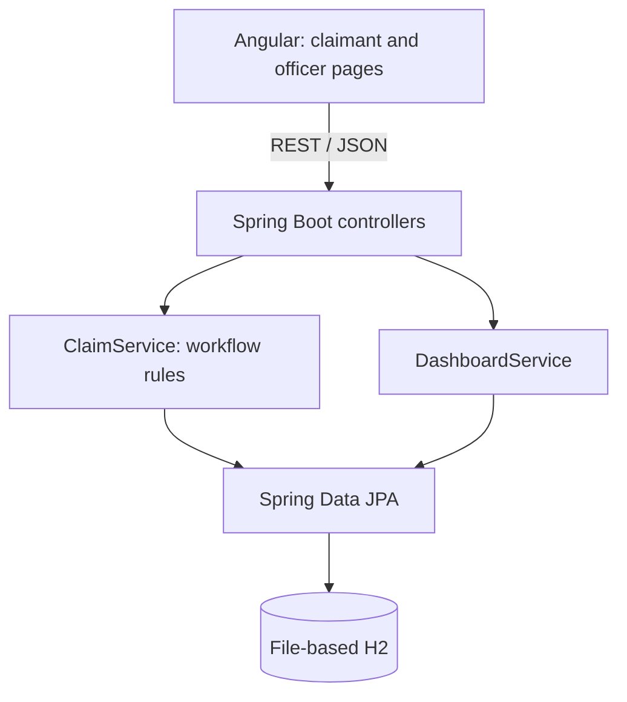

# Architecture notes

These are the decisions behind my ClaimsFlow prototype and the trade-offs I would discuss in the technical walkthrough.

## The problem I'm solving

Chubb's brief describes a claims process spread across email, phone calls and spreadsheets. Customers don't have a clear way to track their claims, and officers and managers don't have a shared view of work or exposure.

I focused on one end-to-end journey: **submit a claim → review it → ask for more details if needed → make a decision → settle or reject**. Both claimant and officer screens live in one Angular application, as required.

## High-level design



I chose one Spring Boot application rather than microservices. The code is split into claim, reporting and common packages so the responsibilities are still clear.

For this assessment, one application means fewer setup steps, simpler testing and one database transaction for the claim update and its history. If different parts of the system needed to scale or be owned by different teams later, I would revisit the service boundaries.

## Main data model

- **Claim:** who submitted it, claim type, market, incident details, claimed amount, reserve, approved amount, assigned officer, status and timestamps.
- **ClaimActivity:** action taken, actor, message, resulting status and timestamp.

A claim has multiple activity records. I wanted the history to explain *how* a claim reached its current status, not just show the latest value.

The project stores money using Java `BigDecimal` instead of floating-point types. `Claim` also has a JPA `@Version` field to help detect conflicting updates.

The data is kept in a local H2 database. I used it because the project can be started without installing a separate database server. For a real service, I'd choose a managed database and use migration scripts instead of automatic schema updates.

## Workflow rules

```text
SUBMITTED --assign--> IN_REVIEW
IN_REVIEW --request info--> NEEDS_INFORMATION --reply--> IN_REVIEW
IN_REVIEW --approve--> APPROVED --settle--> SETTLED
IN_REVIEW --reject--> REJECTED
```

I put these checks in `ClaimService`, not only in Angular. For example, the service won't settle a rejected claim, and it checks the supplied officer ID against the one assigned to the claim.

This officer check is **not real authorization** because the current client can provide an officer ID. In a production system, I would use an authenticated identity and enforce role, ownership and market access on the server.

A status change and its activity record are saved as one transaction. That way I don't end up with a changed claim and a missing history entry if the transaction fails.

## How frontend and backend communicate

Angular has a `ClaimApiService` that uses `HttpClient`. The page components call this service, then use the response to update the UI. The local Angular development server proxies `/api` requests to Spring Boot.

For a claim submission, the request goes through:

```text
NewClaimComponent
  -> ClaimApiService (HTTP POST)
  -> ClaimController (request validation)
  -> ClaimService (create claim and history)
  -> ClaimRepository (H2)
  -> JSON response
  -> Angular success message with claim number
```

This keeps form/display code away from database and business-rule code. It also gives the frontend a clear JSON API contract.

## Frontend pages and the decisions behind them

I was new to Angular, so I traced the screens in the order a user would encounter them.

**New claim:** The form uses `FormsModule` and `[(ngModel)]` to bind fields to one request object. On submission it calls the API service, and the component displays loading, success or error state depending on the response. I like that the component doesn't need to know how the backend saves the claim.

**My claims:** `ngOnInit()` loads a customer's claims. Selecting a row loads its history. If the status is `NEEDS_INFORMATION`, the page exposes a reply form and calls the information endpoint. Real authentication and ownership checks are not present.

**Claims queue:** The officer screen keeps a selected claim and calls different API actions for assign, reserve, request info, decision and settlement. A common `execute()` function handles the returned claim or error. That is useful, but the inline template is large enough that I would separate it into an HTML file as one of my next changes.

**Dashboard:** Angular renders a `DashboardResponse` from `/api/dashboard`; the aggregation happens in Java, not the browser. This means changing the exposure calculation does not require rewriting the Angular page.

Each page is lazy-loaded using `app.routes.ts`. `ClaimApiService` centralizes `HttpClient` calls. The `/api` development proxy points to Spring Boot on port 8080, which avoids repeating a hard-coded backend URL in each component.

## Engineering scenarios I want to test

These are possible failure cases for future changes, not confirmed bugs in this version:

- Form values missing from a POST because a template binding is wrong.
- An outdated selected status or activity timeline after a successful officer action.
- A direct API request attempting an invalid status transition even if the UI hides the button.
- Slow or overly large queue responses when claim volume increases without pagination.
- Accidentally combining financial exposure in different currencies.
- Concurrent assignment or decision changes from two officer sessions.

I'll use small tests and actual API responses to decide whether each scenario needs a code change, rather than adding complexity just in case.

## Why REST, and where Kafka would fit

I used REST for submitting, viewing, assigning and deciding claims. The user needs an immediate answer, especially for submission and decisions.

I considered Kafka for tasks that can happen after the main action, such as sending notifications or updating other reporting systems. **There is no Kafka implementation in this version.**

If I added it, I would first store an outbox event in the same transaction as the claim update. A separate publisher would send it to Kafka and retry if necessary. Consumers would need to handle repeat deliveries. I wouldn't publish an event directly and assume the database and message broker always succeed together.

## Dashboard and liability exposure

The dashboard shows basic counts and workload by officer. For open claims, it calculates a simple exposure estimate:

1. Use the approved amount for approved, unsettled claims.
2. Otherwise use the entered reserve if there is one.
3. Otherwise fall back to the amount the customer claimed.

Settled and rejected claims are excluded from open exposure. Values are grouped by market and currency because adding MYR, SGD and other currencies into one number would be misleading.

This is only a demo calculation. Real liability reporting would need policy limits, financial reserves, FX rules and a proper reporting cut-off. The current implementation also loads claims into memory, which I would replace with database aggregation and pagination as the dataset grows.

## Current limitations

The main things missing are real login and authorization, policy/coverage validation, evidence uploads, secure customer data handling, notifications, actual settlement payments and automated frontend tests. The six markets in the enum are examples because the brief doesn't name the markets.

I also haven't implemented Kafka, an outbox, database migrations or performance monitoring. These are possible next steps, not existing features.

## Testing and next improvements

The backend includes Spring MVC integration tests for key operations and invalid workflow changes. My first test compilation failed because of an error in the generated Java strings. After correcting the test file, `mvn clean test` passed locally.

My next priorities would be to strengthen edge-case tests, add database-side filtering, split large Angular templates into separate files, improve input/error messages and test the exact financial dashboard calculations.

The main trade-off here is deliberate: I wanted a small, working claims process that I could run and explain rather than a bigger system with more technologies but incomplete behavior.
